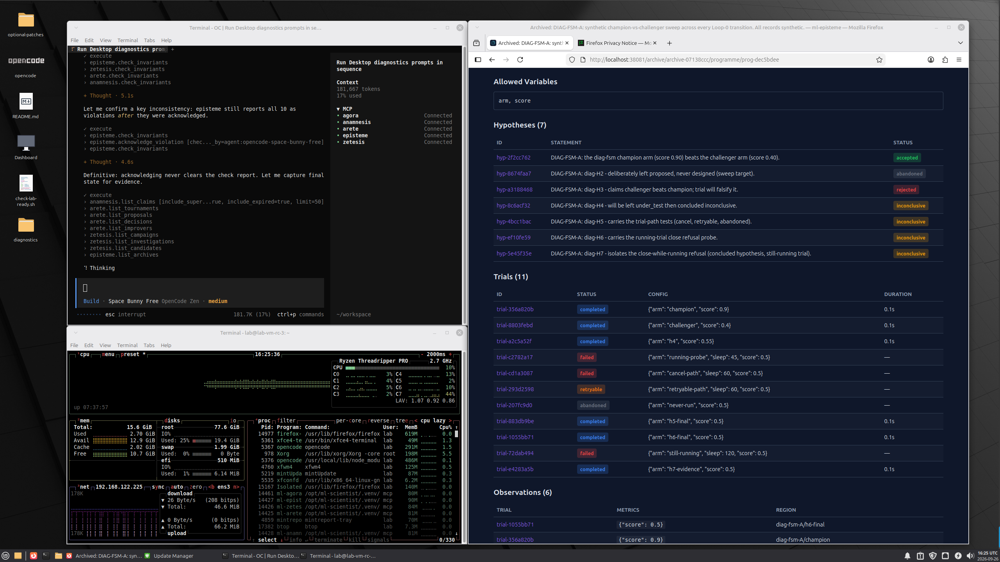

<!-- markdownlint-disable MD033 MD041 MD001 -->
<div align="center">

# GnosisLab-VM

### A virtualized, isolated environment for GnosisLab research workflows

**Build a sealed KVM lab template once — clone a trusted sandbox for every experiment.**

[](LICENSE)
[](https://github.com/cloudcell/gnosislab-vm/actions/workflows/repository-hygiene.yml)
[](https://github.com/cloudcell/gnosislab)
[](https://huggingface.co/buckets/cloudcell/LabLoop)
[](https://github.com/cloudcell/gnosislab-vm)
[](https://discord.com/invite/v9JVtpVuUT)
[](CHANGELOG.md)

[Requirements](#requirements) · [Build locally](#getting-started-build-locally) · [Published image](#using-a-published-vm-image) · [Operations](#operations) · [MCP](#mcp-connectivity) · [Security](SECURITY.md) · [GnosisLab](https://github.com/cloudcell/gnosislab) · [Docs](https://loop.cloudcell.workers.dev/docs)

</div>

---

GnosisLab-VM provides a KVM/libvirt virtual machine for running [GnosisLab](https://github.com/cloudcell/gnosislab) and AI-assisted or human-led experiments with additional isolation between the agent interface, trusted scientific services, and execution of potentially untrusted code. It includes a VM template builder, clone/import workflows, containerized execution environments, data-transfer tooling, and security/readiness checks.

**GnosisLab is the scientific research-process runtime. GnosisLab-VM is its optional virtualized environment.** The core GnosisLab services can run without this repository. GnosisLab-VM does not orchestrate agents and does not guarantee containment against every threat.



## What it provides

| Layer | Purpose |
| --- | --- |
| **Host** | Linux host running KVM/QEMU and libvirt (`qemu:///system`); builds, clones, imports, and controls VM instances. |
| **Driver zone** | Guest desktop and agent clients such as OpenCode/VSCodium, under guest user `lab`. |
| **Trusted zone** | GnosisLab MCP services and scientific state, running in a dedicated rootless Podman container under `mcp`. |
| **Experiment zone** | Separate, restricted Podman container under `exp` for generated or untrusted experiment code. |
| **Data movement** | Host-initiated import/export via the QEMU guest agent; no guest-accessible host filesystem by default. |

The five GnosisLab services are **Agora**, **Arete**, **Zetesis**, **Episteme**, and **Anamnesis**. This environment separates research records from experimental execution, while GnosisLab itself supplies scientific state, provenance, and methodological controls.

**Security boundary:** KVM is the host isolation layer. Containers, accounts, filesystem permissions, firewall rules, and constrained execution wrappers provide additional separation inside the guest. Agent-supplied code and returned artifacts remain untrusted. Anyone with guest administrative credentials can defeat in-guest boundaries; host security depends on QEMU, libvirt, the host kernel, configuration, and patching. See [Security](SECURITY.md) and [the guest security manual](deploy/SECURITY-MANUAL.md).

## Requirements

- x86-64 Linux host with hardware virtualization enabled and `/dev/kvm` available.
- Working QEMU/KVM, system libvirt, `virsh`, `virt-install`, `virt-clone`, UEFI firmware (OVMF), and `virt-sysprep`/libguestfs tooling. The build script can help identify/install missing system packages.
- A Linux Mint ISO or access to the build script's ISO provisioning workflow, plus network access for dependencies (unless using a prepared offline cache).
- Sufficient host CPU, memory, and disk. Defaults in `labloop.conf` request 16 GiB RAM, 16 vCPUs (subject to host clamping), and the builder provisions a VM disk; adjust to your host before building.
- Sudo access and appropriate local libvirt permissions. Do **not** run this on a shared or production host without reviewing the isolation assumptions.

Development and build provenance are documented in [WORKFLOW.md](WORKFLOW.md). This is **alpha software**, not a production-certified sandbox.

## Getting started: build locally

```bash
git clone https://github.com/cloudcell/gnosislab-vm.git
cd gnosislab-vm

# Review VM sizing and display settings first.
cat labloop.conf

# Build, prepare and clone a guest.
./00-build-lab-template.sh
./01-prepare-template-for-cloning.sh
./02-create-vm-from-template.sh researcher
```

A clone is conventionally named `lab-vm-researcher`. Start it with `virsh -c qemu:///system start lab-vm-researcher` or through `virt-manager`. The build and clone scripts perform readiness/security checks; verify the reported results instead of assuming completion means every control passed.

**Important credentials:** locally built templates may use an initial `lab`/`lab` login followed by a forced change; published images use sealed accounts and an importer-provisioned one-time credential. Never publish an unsealed VM image or distribute default credentials. Refer to [WORKFLOW.md](WORKFLOW.md) for release and import details.

**Optional offline build:** populate and verify the cache using `./selfbuild/prefetch-cache.sh` before running `LABLOOP_OFFLINE=1 ./00-build-lab-template.sh`. Keep caches and downloaded image artifacts out of version control.

## Using a published VM image

A historical image distribution location is [the Cloudcell LabLoop Hugging Face bucket](https://huggingface.co/buckets/cloudcell/LabLoop). That bucket name is a **legacy distribution path**, not the product name; check availability and publisher authenticity before relying on an image. Images are not hosted in this Git repository.

Download a `.qcow2` image and its matching `.sha256`, verify the digest and, when available, the publisher's authenticated release manifest or signature, then import:

```bash
sha256sum -c image.qcow2.sha256
./20-import-lab-vm.sh image.qcow2 researcher
```

A checksum obtained from the same untrusted source only detects corruption, **not** a malicious replacement. Review the image provenance and [security policy](SECURITY.md) before use.

## Operations

Run the numbered commands **on the Linux host** from the repository root unless stated otherwise.

| Command | Function |
| --- | --- |
| `00-build-lab-template.sh` | Provision a template VM. |
| `01-prepare-template-for-cloning.sh` | Shut down, scrub instance identity and prepare a template for cloning. |
| `02-create-vm-from-template.sh <name>` | Clone a VM for a user or experiment. |
| `10-upload-template-to-hf.sh` | Seal and upload a candidate image to the configured HF bucket. |
| `11-release-template.sh` | Promote a candidate image to the configured release bucket. |
| `20-import-lab-vm.sh <image> [name]` | Import a downloaded QCOW2 image. |
| `30-ensure-lab-tools.sh <vm>\|all` | Reconcile tools/configuration on an existing VM. |
| `80-ingest-lab-data.sh <vm> <src> [batch]` | Stage host data into the guest through the approved path. |
| `90-extract-lab-data.sh <vm> [destination]` | Pull staged exported artifacts from the guest. |

Guest-side operational commands, including `labloop-exec`, `labloop-export`, `labloop-build`, and `labloop-fault`, retain their **historical executable names for compatibility**. They are components of GnosisLab-VM, not separate current products. Read the [operational workflow](WORKFLOW.md) and [data-movement manual](deploy/DATA-MOVEMENT-MANUAL.md) before using them.

**Do not automatically open extracted archives on the host.** Experiment output may be malicious or sensitive even when its checksum matches. Inspect it in an appropriate isolated environment.

## MCP connectivity

The guest's agent clients connect to the GnosisLab services on the guest loopback interface. Current packaged defaults are:

| Service | MCP endpoint | GUI |
| --- | --- | --- |
| Agora | `127.0.0.1:28050/mcp` | `28051` |
| Arete | `127.0.0.1:28060/mcp` | `28061` |
| Zetesis | `127.0.0.1:28070/mcp` | `28071` |
| Episteme | `127.0.0.1:28080/mcp` | `28081` |
| Anamnesis | `127.0.0.1:28090/mcp` | `28091` |

The execution/data-ingest interface may use additional ports. **Ports are driven by the installed GnosisLab package's `ports.env` and can change**; inspect the guest configuration instead of hardcoding them in new integrations.

For standalone installation, consult [GnosisLab](https://github.com/cloudcell/gnosislab), its [documentation](https://loop.cloudcell.workers.dev/docs), and the [PyPI package](https://pypi.org/project/gnosislab/).

## Compatibility and migration

This project was previously called **LabLoop** or **ML-LabLoop**. Repository branding is now **GnosisLab-VM**, while the scientific runtime is **GnosisLab**. The historical `labloop-*` commands, `LABLOOP_*` settings, guest `/srv/lab/...` paths, and Hugging Face bucket names remain temporarily unchanged because they are operational interfaces or distribution locations. Do not rename them casually: preserve compatibility until migration procedures and tests exist.

## Documentation and project policies

- [Build, import and operational workflow](WORKFLOW.md)
- [Security policy and private vulnerability reporting](SECURITY.md)
- [Guest security model and operational rules](deploy/SECURITY-MANUAL.md)
- [Data movement and extraction](deploy/DATA-MOVEMENT-MANUAL.md)
- [Contributing](CONTRIBUTING.md)
- [Changelog](CHANGELOG.md)
- [Citation metadata](CITATION.cff)
- [Apache 2.0 license](LICENSE) and [third-party notices](legal/THIRD-PARTY-NOTICES.md)

Bug reports and feature proposals are welcome via [GitHub issues](https://github.com/cloudcell/gnosislab-vm/issues). **For vulnerabilities, follow [SECURITY.md](SECURITY.md), not public issues.**
